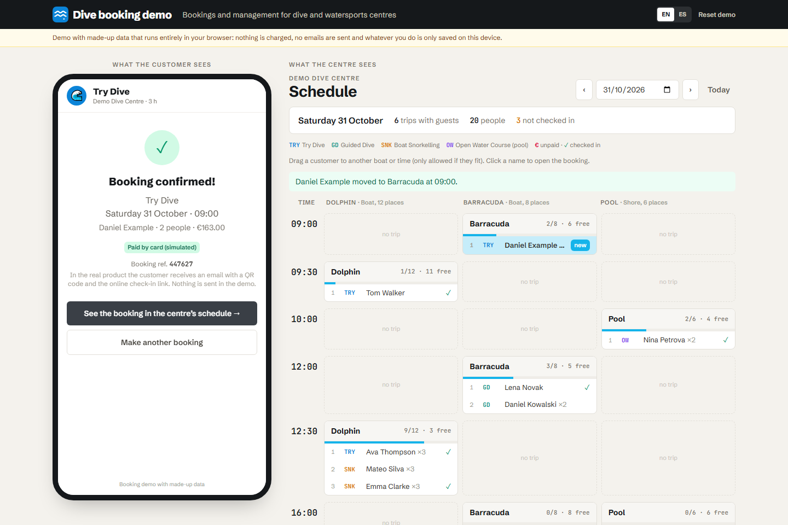
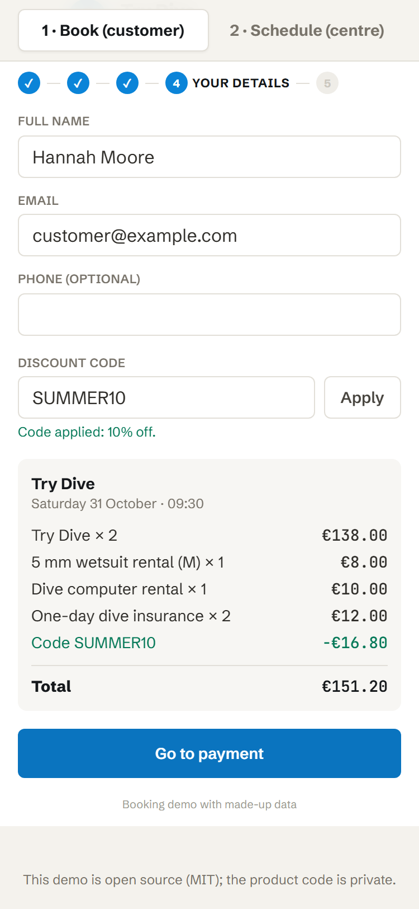
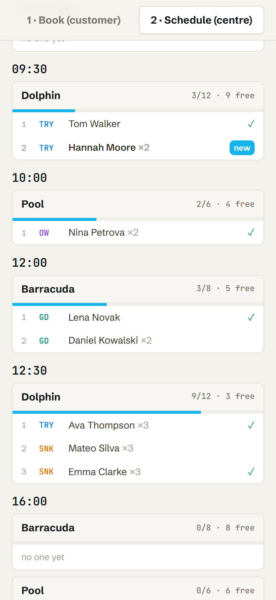

# Dive centre booking demo

**An interactive demo of a booking and management SaaS for dive centres that I built and run in production: paid online bookings, boat schedule, check-in, invoices and staff in a single panel.**

This demo runs entirely in the browser, with no server: book the way a customer would on their phone, then watch the booking show up in the centre's schedule.

Interface in English and Spanish (switch in the header).

👉 **Try it:** [miguelpalaciosgg.github.io/dive-booking-demo](https://miguelpalaciosgg.github.io/dive-booking-demo/)



| Booking on a phone | The booking in the schedule |
|---|---|
|  |  |

## What you can do in the demo

1. **Book as a customer** (mobile-first widget): activity → day and slot with free places → people, gear rental with sizes and extras → details and discount code (try `SUMMER10` or `DEMO5`; `VERANO10` in Spanish) → **simulated** payment.
2. **See the centre's schedule** (Day view): one row per time slot and each boat's trips with places taken/free. The new booking is highlighted. On desktop you can **drag** a customer to another boat or time (only if they fit).
3. **Open a booking**: payment status and front-desk payment, check-in, move to another trip (this is how you do it on a phone) and cancel.

On wide screens the widget (inside a phone frame) and the schedule are shown side by side; on a phone they are two tabs. "Reset demo" in the header brings back the sample data. Add `?lang=es` to the URL to open it in Spanish.

## What is real in production and what is simulated here

| | The product (in production) | This demo |
|---|---|---|
| Data | Own multi-tenant API with PostgreSQL | In memory and your browser's `localStorage` |
| Payment | The centre's bank terminal via Redsys: card and Bizum, with refunds | Simulated screen: nothing is charged and no card details are asked for |
| Emails | Confirmation with QR code, online check-in link, invoice and survey | Nothing is sent |
| Invoices | Sequential numbering and submission to the Spanish tax agency with Verifactu | Not included |
| Check-in | The customer fills it in on their phone (details, health, certification, signature) | A button in the booking card |
| Centre subscription | Stripe subscription (Base and Pro plans) | Not included |
| More | Watersports board, fleet and boarding list, staff and time clock, gift vouchers, reports, centre website, customer "My booking" page | — |

The centre, boats, activities, prices and customers in the demo are **made up**.

## Production stack

- **Frontend:** Vue 3, Vite and Tailwind CSS
- **Backend:** Node.js with Express
- **Database:** PostgreSQL
- **Payments:** Redsys (card and Bizum) for bookings; Stripe for centre subscriptions
- **Invoicing:** Verifactu (records submitted to the Spanish tax agency)
- **Deployment:** Docker + Caddy (automatic HTTPS) on an EU VPS, with encrypted backups
- **Testing:** Playwright end to end and a busy-day simulator with concurrent bookings

The product code is **private**. This repository only contains the demo, built separately with the same look (Vue 3 + Vite + Tailwind) and no part of the backend.

## Run it locally

```bash
npm install
npm run dev       # development
npm run build     # builds dist/ (relative paths, ready for GitHub Pages)
npm run preview   # serves dist/
```

`.github/workflows/pages.yml` publishes `dist/` to GitHub Pages on every push to `main` (in the repo: Settings → Pages → Source: GitHub Actions).

## Structure

```
src/
  almacen.js                 demo data and logic (capacity per boat, prices, discounts, moving, payments)
  i18n.js                    English and Spanish texts, t() and the language switch
  App.vue                    layout: widget + schedule, tabs on mobile, language switch
  components/
    WidgetReserva.vue        customer booking with simulated payment
    AgendaDia.vue            day schedule by boat and time, drag and drop
    FichaReserva.vue         booking card: payment, check-in, move, cancel
    Marca.vue                neutral logo (wave icon)
```

## License

The code of this demo is released under the [MIT](LICENSE) license.
